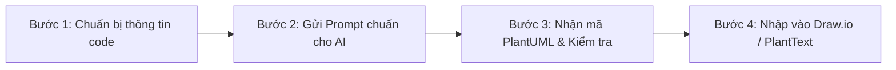

# HƯỚNG DẪN DÙNG AI ĐỂ VẼ CLASS & SEQUENCE DIAGRAM CHUẨN THIẾT KẾ HỆ THỐNG (JOURNEYGO)

> **Mục đích tài liệu**: Cung cấp quy chuẩn (Rules), phương pháp chia nhỏ tính năng (Prompt Engineering) và quy trình từng bước để các thành viên trong nhóm dùng AI (ChatGPT, Claude, Gemini, Antigravity...) sinh mã **PlantUML** cho **Class Diagram** và **Sequence Diagram**, sau đó render trực tiếp lên **Draw.io** / **PlantText** đồng bộ 100% phong cách thiết kế hệ thống.

---

## 1. NGUYÊN TẮC BẮT BUỘC (CORE RULES)

Để toàn bộ tài liệu thiết kế của dự án đồng nhất, mọi thành viên khi yêu cầu AI tạo sơ đồ **PHẢI** tuân thủ các quy tắc sau:

### Rule 1: Ngôn ngữ trong biểu đồ (100% English)
- **Tất cả các định danh, nhãn (label), phương thức, chú thích, thông báo lỗi trong biểu đồ PHẢI viết bằng tiếng Anh**.
- *Lý do*: Đáp ứng chuẩn báo cáo đồ án phần mềm chuyên nghiệp và tránh lỗi font khi render trên Draw.io / PlantText.

### Rule 2: Mô hình kiến trúc phân tầng (Monolith Standard)
- Áp dụng nghiêm ngặt trục phân tầng dọc:
  $$\textbf{Controller} \xrightarrow{\textbf{use}} \textbf{Service} \xrightarrow{\textbf{use}} \textbf{Repository} \xrightarrow{\textbf{use}} \textbf{Entity}$$
- `Repository` luôn kế thừa (`--|> extend`) từ `JpaRepository`.
- **Tuyệt đối KHÔNG đưa các thành phần Microservice thừa** (như `API Gateway`, `Kafka`, `Eureka`, `Message Queue`) vào biểu đồ nếu tính năng đó đang chạy trên kiến trúc Monolith Spring Boot của dự án.

### Rule 3: Quy tắc chia nhỏ tính năng (Atomic Feature Rule)
- **Không gom chung nhiều luồng khác nhau vào 1 diagram**.
- Phải tách riêng từng ca sử dụng (Use-case):
  - *Ví dụ*: Đăng ký tách làm 2: `Register with Email & Password` và `Register with Google OAuth2`.
  - Đăng nhập tách làm 2: `Login with Email & Password` và `Login with Google`.
  - Quản lý hồ sơ tách làm 2: `View Profile` và `Update Profile`.
- Việc chia nhỏ giúp biểu đồ không bị rối mắt, rõ ràng các nhánh rẽ (`alt [valid] ... else [invalid]`) và dễ chấm điểm.

### Rule 4: Khớp 100% với Codebase thực tế
- Tên class, tên method, tên trường DTO/Entity phải đối chiếu khớp với source code của backend:
  - Controller: `AuthController`, `DestinationController`, `TourController`...
  - DTO: `LoginRequest`, `RegisterRequest`, `AuthResponse`, `ApiResponse`...
  - Entity: `User`, `Role`, `Destination`, `Tour`...

### Rule 5: Quy chuẩn Lifeline trong Sequence Diagram (`UI` & `:ClassName`)
- **Tầng giao diện người dùng**: Chuẩn hóa thành **`UI`** (ngắn gọn, thống nhất cho cả Web và Mobile App, không ghi dài dòng `Client (Mobile App)` hay `Frontend`).
- **Các thành phần Backend**: Trên lifeline sử dụng cú pháp thể hiện đối tượng UML chuẩn dạng **`:ClassName`** (ví dụ: `:SettlementController`, `:SettlementService`, `:WalletRepository`, `:Database`).
- **Không dùng stereotype `<<Controller>>` hay `<<Service>>` trên lifeline** của Sequence Diagram để sơ đồ không bị rối mắt và đúng chuẩn UML tương tác (Interaction Diagram).

### Rule 6: Nguyên tắc khép kín mũi tên phản hồi (No Protruding Arrows)
- Tuyệt đối **KHÔNG dùng mũi tên cụt đâm ra ngoài biên** (như cú pháp `[<-- Service`).
- Mọi mũi tên phản hồi trong tất cả các nhánh `alt ... else` (dù là lỗi hay thành công) **PHẢI** trả tuần tự ngược về qua từng tầng:
  $$\textbf{:Database} \rightarrow \textbf{:Repository} \rightarrow \textbf{:Service} \rightarrow \textbf{:Controller} \rightarrow \textbf{UI} \rightarrow \textbf{Actor}$$
- Đảm bảo tất cả các điểm kết thúc của nhánh lỗi hay thành công đều nằm gọn gàng bên trong khối `alt` tương ứng.

### Rule 7: Chuẩn hiển thị dấu `+` và `-` trong Class Diagram (Visibility Modifiers)
- Mặc định PlantUML sẽ tự động đổi `+` thành chấm tròn xanh lá và `-` thành ô vuông đỏ.
- **Bắt buộc thêm cấu hình**:
  ```plantuml
  skinparam classAttributeIconSize 0
  ```
- Dòng lệnh này tắt icon đồ họa và đưa về hiển thị đúng các ký tự văn bản chuẩn UML: `+` (public), `-` (private), `#` (protected).

### Rule 8: Thiết kế Class Diagram tinh gọn (Compact & Focused Sizing)
- Để sơ đồ vừa vặn trang báo cáo A4 (Word/PDF) mà không bị chữ quá bé khi chèn ảnh:
  - Thêm cấu hình khoảng cách:
    ```plantuml
    skinparam nodesep 20
    skinparam ranksep 25
    skinparam fontSize 11
    ```
  - **Không vẽ các bảng Enum rời** nếu không thật sự cần thiết (kiểu Enum đã được thể hiện trực tiếp trong kiểu thuộc tính của Class).
  - Chỉ tập trung vào các trường và hàm trọng tâm liên quan trực tiếp đến tính năng đang mô tả (bỏ bớt getter/setter và các trường thời gian phụ `createdAt`, `updatedAt`).

---

## 2. QUY TRÌNH 4 BƯỚC THỰC HIỆN VỚI AI



### Bước 1: Chuẩn bị thông tin trước khi hỏi AI
Xác định 4 file mã nguồn cốt lõi của tính năng cần vẽ:
1. `Controller` tương ứng (vd: `AuthController.java` hoặc `TourController.java`).
2. `Service` xử lý nghiệp vụ (vd: `AuthService.java` hoặc `TourService.java`).
3. `Repository` truy vấn dữ liệu (vd: `UserRepository.java`, `TourRepository.java`).
4. `Entity` liên quan (vd: `User.java`, `Tour.java`).

---

### Bước 2: Mẫu Prompt chuẩn gửi AI (Copy & Điền)

Hãy copy nguyên văn khung Prompt dưới đây, thay đổi tên tính năng và gửi cho AI:

```markdown
Tôi đang làm tài liệu thiết kế hệ thống (System Design Document) cho dự án Backend Spring Boot (Monolith).
Hãy giúp tôi viết mã PlantUML cho Class Diagram và Sequence Diagram cho tính năng: [TÊN TÍNH NĂNG Ở ĐÂY - Ví dụ: "Credit Settlement to Partner Wallet"]

YÊU CẦU BẮT BUỘC (STRICT RULES):
1. NGÔN NGỮ: Toàn bộ chữ trong diagram (tên lớp, hàm, biến, note, nhánh alt, message) PHẢI là 100% TIẾNG ANH.
2. KIẾN TRÚC: Tuân thủ nghiêm ngặt mô hình phân tầng: Controller -> Service -> Repository -> Entity. 
   - Không dùng API Gateway hay Kafka (dự án là Monolith).
   - Repository phải extend JpaRepository.
3. PHONG CÁCH CLASS DIAGRAM:
   - Nền trắng viền đen (skinparam BackgroundColor White, ArrowColor Black, BorderColor Black).
   - Bố cục trục dọc rõ ràng: Controller -> Service -> Repository -> Entity.
   - Thể hiện rõ stereotype trên Class: <<Controller>>, <<Service>>, <<Repository>>, <<Entity>>, <<DTO>>.
   - Luôn có: skinparam classAttributeIconSize 0 để hiển thị dấu + và - chuẩn văn bản (không dùng ô vuông đỏ, chấm tròn xanh lá).
   - Thiết kế tinh gọn (Compact): skinparam nodesep 20, skinparam ranksep 25, fontSize 11. Không vẽ bảng Enum rời nếu không cần thiết.
4. PHONG CÁCH SEQUENCE DIAGRAM:
   - Lifelines theo thứ tự: Actor -> UI -> :Controller -> :Service -> :Repository -> :Database.
   - Tầng giao diện người dùng ghi là "UI".
   - Các thành phần Backend sử dụng cú pháp đối tượng UML dạng ":ClassName" (ví dụ: :SettlementController, :SettlementService). Không dùng stereotype <<Controller>> trên lifeline.
   - Bắt buộc thể hiện các nhánh rẽ [alt ... else] khép kín:
     + Nhánh lỗi (Invalid input / Not found / Unauthorized / Conflict)
     + Nhánh thành công (Persist DB -> Generate Response -> 200 OK / 201 Created)
   - Tuyệt đối không dùng mũi tên cụt ra ngoài biên. Mọi return arrow phải trả tuần tự ngược về qua :Controller -> UI -> Actor bên trong khối alt/else.
   - Sử dụng skinparam style strictuml, skinparam responseMessageBelowArrow true.

Dưới đây là ngữ cảnh code liên quan (Controller, Service, Repository, Entity):
[DÁN CODE HOẶC MÔ TẢ NGẮN CỦA CONTROLLER & SERVICE VÀO ĐÂY]
```

---

## 3. CÁCH RENDER VÀO DRAW.IO & XUẤT HÌNH ẢNH

Sau khi AI sinh ra đoạn code PlantUML (bắt đầu bằng `@startuml` và kết thúc bằng `@enduml`), các bạn dùng 1 trong 2 cách sau để lấy hình:

### Cách 1: Render qua PlantText và xuất SVG (Khuyên dùng cho Word / Báo cáo)
1. Mở trang [PlantText.com](https://www.planttext.com/) hoặc [PlantUML Web Server](https://www.plantuml.com/plantuml/uml/).
2. Dán mã PlantUML vào khung soạn thảo.
3. Chọn xuất ra file **SVG** (hoặc PNG).
4. Bạn có thể:
   - **Chèn trực tiếp file SVG vào Word/Google Docs**: Hình vector cực kỳ sắc nét, thu phóng to nhỏ thoải mái không vỡ hạt hay tràn trang, hiển thị đúng 100% dấu `+` và `-` màu đen trắng.
   - **Kéo thả file SVG vào Draw.io**: Draw.io sẽ giữ nguyên 100% đồ họa gốc, không bị tự ý ép đổi icon.

### Cách 2: Chèn trực tiếp vào Draw.io
1. Mở trang [Draw.io (app.diagrams.net)](https://app.diagrams.net/) hoặc ứng dụng Draw.io trên máy.
2. Trên thanh menu trên cùng, chọn:
   $$\textbf{Arrange} \rightarrow \textbf{Insert} \rightarrow \textbf{Advanced} \rightarrow \textbf{PlantUML...}$$
3. Xóa nội dung mẫu, dán toàn bộ đoạn mã PlantUML do AI tạo ra vào và bấm **Insert**.
4. Biểu đồ sẽ xuất hiện ngay trên trang vẽ. Bạn có thể chọn toàn bộ (`Ctrl + A`) và giữ `Shift` kéo góc để thu phóng theo kích thước mong muốn.

---

## 4. CHECKLIST KIỂM TRA TRƯỚC KHI NỘP BÁO CÁO

Trước khi chèn hình vào tài liệu thiết kế, hãy tự đối chiếu nhanh danh sách kiểm tra sau:

- [ ] Toàn bộ text trên diagram đã là **100% tiếng Anh** chưa?
- [ ] Diagram có bị dính các thành phần thừa như **API Gateway**, **Kafka** không? (Nếu có thì phải xóa bỏ).
- [ ] Class Diagram đã có cấu hình `skinparam classAttributeIconSize 0` để hiện dấu `+` và `-` chưa?
- [ ] Class Diagram đã được tinh gọn (bỏ bảng Enum rời, tối ưu kích thước) để vừa trang A4 chưa?
- [ ] Sequence Diagram lifeline đã dùng **`UI`** và cú pháp **`:ClassName`** chưa?
- [ ] Sequence Diagram có mũi tên nào bị cụt đâm ra ngoài biên không? (Tất cả phải trả về tuần tự đến `UI` và `Actor` trong khối `alt`).
- [ ] Đã tách nhỏ thành các use-case độc lập chưa (không gộp chung nhiều tính năng khác luồng vào 1 biểu đồ)?

---
*Tài liệu lưu hành nội bộ nhóm phát triển JourneyGo.*
