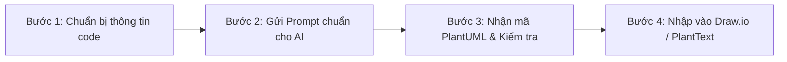

# HƯỚNG DẪN DÙNG AI ĐỂ VẼ CLASS & SEQUENCE DIAGRAM CHUẨN THIẾT KẾ HỆ THỐNG (JOURNEYGO)

> **Mục đích tài liệu**: Cung cấp quy chuẩn (Rules), phương pháp chia nhỏ tính năng (Prompt Engineering) và quy trình từng bước để các thành viên trong nhóm dùng AI (ChatGPT, Claude, Gemini, Antigravity...) sinh mã **PlantUML** cho **Class Diagram** và **Sequence Diagram**, sau đó render trực tiếp lên **Draw.io** / **PlantText** đồng bộ 100% phong cách thiết kế hệ thống.

---

## 1. NGUYÊN TẮC BẮT BUỘC (CORE RULES)

Để toàn bộ tài liệu thiết kế của dự án đồng nhất, mọi thành viên khi yêu cầu AI tạo sơ đồ **PHẢI** tuân thủ các quy tắc sau:

### Rule 1: Ngôn ngữ trong biểu đồ (100% English)
- **Tất cả các định danh, nhãn (label), phương thức, chú thích, thông báo lỗi trong biểu đồ PHẢI viết bằng tiếng Anh**.
- *Lý do*: Đáp ứng chuẩn báo cáo đồ án phần mềm chuyên nghiệp và tránh lỗi font khi render trên Draw.io / PlantText.

### Rule 2: Mô hình kiến trúc phân tầng (Monolith Standard)
- Áp dụng nghiêm ngặt trục phân tầng dọc:
  $$\textbf{Controller} \xrightarrow{\textbf{use}} \textbf{Service} \xrightarrow{\textbf{use}} \textbf{Repository} \xrightarrow{\textbf{use}} \textbf{Entity}$$
- `Repository` luôn kế thừa (`--|> extend`) từ `JpaRepository`.
- **Tuyệt đối KHÔNG đưa các thành phần Microservice thừa** (như `API Gateway`, `Kafka`, `Eureka`, `Message Queue`) vào biểu đồ nếu tính năng đó đang chạy trên kiến trúc Monolith Spring Boot của dự án.

### Rule 3: Quy tắc chia nhỏ tính năng (Atomic Feature Rule)
- **Không gom chung nhiều luồng khác nhau vào 1 diagram**.
- Phải tách riêng từng ca sử dụng (Use-case):
  - *Ví dụ*: Đăng ký tách làm 2: `Register with Email & Password` và `Register with Google OAuth2`.
  - Đăng nhập tách làm 2: `Login with Email & Password` và `Login with Google`.
  - Quản lý hồ sơ tách làm 2: `View Profile` và `Update Profile`.
- Việc chia nhỏ giúp biểu đồ không bị rối mắt, rõ ràng các nhánh rẽ (`alt [valid] ... else [invalid]`) và dễ chấm điểm.

### Rule 4: Khớp 100% với Codebase thực tế
- Tên class, tên method, tên trường DTO/Entity phải đối chiếu khớp với source code của backend:
  - Controller: `AuthController`, `DestinationController`, `TourController`...
  - DTO: `LoginRequest`, `RegisterRequest`, `AuthResponse`, `ApiResponse`...
  - Entity: `User`, `Role`, `Destination`, `Tour`...

---

## 2. QUY TRÌNH 4 BƯỚC THỰC HIỆN VỚI AI



### Bước 1: Chuẩn bị thông tin trước khi hỏi AI
Xác định 4 file mã nguồn cốt lõi của tính năng cần vẽ:
1. `Controller` tương ứng (vd: `AuthController.java` hoặc `TourController.java`).
2. `Service` xử lý nghiệp vụ (vd: `AuthService.java` hoặc `TourService.java`).
3. `Repository` truy vấn dữ liệu (vd: `UserRepository.java`, `TourRepository.java`).
4. `Entity` liên quan (vd: `User.java`, `Tour.java`).

---

### Bước 2: Mẫu Prompt chuẩn gửi AI (Copy & Điền)

Hãy copy nguyên văn khung Prompt dưới đây, thay đổi tên tính năng và gửi cho AI:

```markdown
Tôi đang làm tài liệu thiết kế hệ thống (System Design Document) cho dự án Backend Spring Boot (Monolith).
Hãy giúp tôi viết mã PlantUML cho Class Diagram và Sequence Diagram cho tính năng: [TÊN TÍNH NĂNG Ở ĐÂY - Ví dụ: "Create Booking with Cash Payment"]

YÊU CẦU BẮT BUỘC (STRICT RULES):
1. NGÔN NGỮ: Toàn bộ chữ trong diagram (tên lớp, hàm, biến, note, nhánh alt, message) PHẢI là 100% TIẾNG ANH.
2. KIẾN TRÚC: Tuân thủ nghiêm ngặt mô hình phân tầng: Controller -> Service -> Repository -> Entity. 
   - Không dùng API Gateway hay Kafka (dự án là Monolith).
   - Repository phải extend JpaRepository.
3. PHONG CÁCH CLASS DIAGRAM:
   - Nền trắng viền đen (skinparam BackgroundColor White, ArrowColor Black, BorderColor Black).
   - Bố cục trục dọc rõ ràng: Controller -> Service -> Repository -> Entity.
   - Thể hiện rõ stereotye: <<Controller>>, <<Service>>, <<Repository>>, <<Entity>>, <<DTO>>.
4. PHONG CÁCH SEQUENCE DIAGRAM:
   - Các lifelines theo thứ tự: Actor (User/Guest) -> Client (Mobile App) -> Controller -> Service -> Repository -> Database.
   - Bắt buộc thể hiện các nhánh rẽ [alt]:
     + Nhánh lỗi (Invalid input / Not found / Unauthorized / Conflict)
     + Nhánh thành công (Persist DB -> Generate Token/Response -> 200 OK / 201 Created)
   - Sử dụng skinparam style strictuml.

Dưới đây là ngữ cảnh code liên quan (Controller, Service, Repository, Entity):
[DÁN CODE HOẶC MÔ TẢ NGẮN CỦA CONTROLLER & SERVICE VÀO ĐÂY]
```

---

## 3. CÁCH RENDER VÀO DRAW.IO & XUẤT HÌNH ẢNH

Sau khi AI sinh ra đoạn code PlantUML (bắt đầu bằng `@startuml` và kết thúc bằng `@enduml`), các bạn dùng 1 trong 2 cách sau để lấy hình:

### Cách 1: Chèn trực tiếp vào Draw.io (Khuyên dùng)
1. Mở trang [Draw.io (app.diagrams.net)](https://app.diagrams.net/) hoặc ứng dụng Draw.io trên máy.
2. Trên thanh menu trên cùng, chọn:
   $$\textbf{Arrange} \rightarrow \textbf{Insert} \rightarrow \textbf{Advanced} \rightarrow \textbf{PlantUML...}$$
   *(Hoặc bấm vào biểu tượng dấu cộng `+` trên thanh công cụ $\rightarrow$ `Advanced` $\rightarrow$ `PlantUML...`)*
3. **Xóa toàn bộ nội dung mẫu** có sẵn trong hộp thoại.
4. **Dán toàn bộ đoạn mã PlantUML** do AI tạo ra vào.
5. Bấm nút **Insert**.
6. *Kết quả*: Biểu đồ sẽ xuất hiện ngay trên trang vẽ với đầy đủ icon $\textcircled{\text{C}}$, $\textcircled{\text{I}}$, mũi tên quan hệ chuẩn nét không bị lệch vị trí.

### Cách 2: Render qua PlantText và xuất SVG
1. Mở trang [PlantText.com](https://www.planttext.com/).
2. Dán mã PlantUML vào khung soạn thảo bên trái.
3. Nhấp chuột phải vào biểu đồ bên phải $\rightarrow$ chọn **Export SVG** (hoặc PNG).
4. Kéo thả file SVG vào Draw.io hoặc chèn thẳng vào file Word / Google Docs báo cáo (ảnh SVG phóng to vô hạn không bao giờ bị mờ vỡ hạt).

---

## 4. CHECKLIST KIỂM TRA TRƯỚC KHI NỘP BÁO CÁO

Trước khi chèn hình vào tài liệu thiết kế, hãy tự đối chiếu nhanh danh sách kiểm tra sau:

- [ ] Toàn bộ text trên diagram đã là **100% tiếng Anh** chưa?
- [ ] Diagram có bị dính các thành phần thừa như **API Gateway**, **Kafka** không? (Nếu có thì phải xóa bỏ).
- [ ] Class Diagram đã có đủ trục: `Controller` $\rightarrow$ `Service` $\rightarrow$ `Repository` $\rightarrow$ `Entity` chưa?
- [ ] `Repository` đã có mũi tên kế thừa (`--|> extend`) lên `JpaRepository` chưa?
- [ ] Sequence Diagram đã có khối `alt ... else` mô tả đầy đủ cả trường hợp thất bại (lỗi dữ liệu, sai quyền...) và trường hợp thành công chưa?
- [ ] Đã tách nhỏ thành các use-case độc lập chưa (không gộp chung nhiều tính năng khác luồng vào 1 biểu đồ)?

---
*Tài liệu lưu hành nội bộ nhóm phát triển JourneyGo.*

