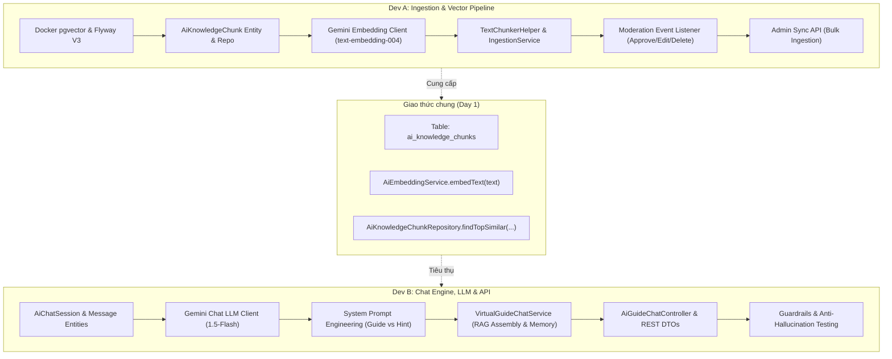
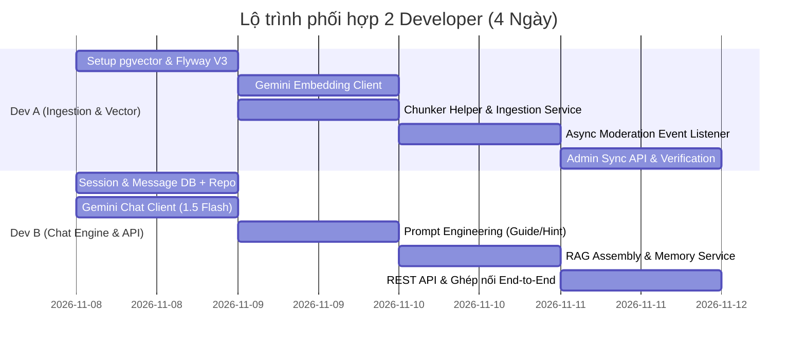

# KẾ HOẠCH TRIỂN KHAI TÍNH NĂNG AI VIRTUAL GUIDE (RAG) CHO 2 DEVELOPER

> **Dự án:** JourneyGo (Backend Modular Monolith - Spring Boot 3.3.5, Java 21, PostgreSQL + pgvector)  
> **Tài liệu đặc tả gốc:** [`AI_RAG_MODULE_SPEC.md`](file:///d:/S9/journey-go/backend/docs/AI_RAG_MODULE_SPEC.md)

---

## 1. NGUYÊN TẮC PHÂN CHIA (DIVISION STRATEGY)

Để 2 lập trình viên (**Dev A** và **Dev B**) có thể phát triển song song mà **không bị nghẽn (block)** và **không xung đột mã nguồn (merge conflicts)**:



---

## 2. GIAO DIỆN CHUNG THỐNG NHẤT TRƯỚC (INTERFACE CONTRACT - DAY 1)

Hai bạn chỉ cần chốt trước 2 interface này vào ngày đầu tiên để Dev B có thể mock dữ liệu làm việc độc lập với Dev A:

### 2.1. Cấu trúc bảng Vector (`V3__ai_virtual_guide_pgvector.sql`)
```sql
CREATE EXTENSION IF NOT EXISTS vector;

CREATE TABLE ai_knowledge_chunks (
    id UUID PRIMARY KEY DEFAULT gen_random_uuid(),
    source_id VARCHAR(100) NOT NULL,      -- VD: "CULTURAL_CONTENT:15", "TOUR:3"
    destination_id BIGINT NOT NULL,       -- Chuẩn BigInt khớp Destination.id
    content_type VARCHAR(50) NOT NULL,   -- 'CULTURAL_STORY', 'TOUR_INFO', 'TASK_HINT'
    chunk_text TEXT NOT NULL,
    metadata JSONB,                      -- {"title": "...", "destination_name": "..."}
    embedding vector(768) NOT NULL,      -- text-embedding-004 (768 chiều)
    created_at TIMESTAMP WITH TIME ZONE DEFAULT CURRENT_TIMESTAMP,
    updated_at TIMESTAMP WITH TIME ZONE DEFAULT CURRENT_TIMESTAMP
);

CREATE INDEX idx_ai_chunks_embedding ON ai_knowledge_chunks USING hnsw (embedding vector_cosine_ops);
CREATE INDEX idx_ai_chunks_destination ON ai_knowledge_chunks(destination_id);
CREATE INDEX idx_ai_chunks_source ON ai_knowledge_chunks(source_id);
```

### 2.2. Service Interface dùng chung
```java
public interface AiEmbeddingService {
    float[] embed(String text);
    List<float[]> embedAll(List<String> texts);
}
```

### 2.3. Repository Query dùng chung
```java
public interface AiKnowledgeChunkRepository extends JpaRepository<AiKnowledgeChunk, UUID> {
    @Query(value = """
        SELECT * FROM ai_knowledge_chunks
        WHERE destination_id = :destinationId
          AND (:contentType IS NULL OR content_type = :contentType)
        ORDER BY embedding <=> cast(:queryVector as vector)
        LIMIT :topK
        """, nativeQuery = true)
    List<AiKnowledgeChunk> searchSimilar(
        @Param("destinationId") Long destinationId,
        @Param("contentType") String contentType,
        @Param("queryVector") String queryVector,
        @Param("topK") int topK
    );

    void deleteBySourceId(String sourceId);
}
```

---

## 3. PHÂN CHIA CHI TIẾT THEO VAI TRÒ

### 👤 DEVELOPER A: Ingestion Pipeline & Vector Database

> **Mục tiêu:** Đảm bảo hệ thống nạp dữ liệu chuẩn, băm nhỏ nội dung thông minh, tính toán vector chính xác và tự động cập nhật khi nội dung duyệt thay đổi.

| Giai đoạn | Nhiệm vụ cụ thể | Đầu ra (Deliverables) |
| :--- | :--- | :--- |
| **P1. Hạ tầng & DB** | - Cập nhật `docker-compose.yml` sang image `pgvector/pgvector:pg16`.<br>- Viết Flyway migration `V3__ai_virtual_guide_pgvector.sql`.<br>- Tạo Entity `AiKnowledgeChunk` và `AiKnowledgeChunkRepository`. | Migration chạy mượt, bảng vector sẵn sàng. |
| **P2. Gemini Embedding** | - Viết `GeminiEmbeddingClient` kết nối API Google `text-embedding-004` (768 dimensions).<br>- Triển khai `AiEmbeddingService` và hàm chuyển đổi vector float array sang định dạng Postgres vector. | Unit test embedding trả về mảng 768 float thành công. |
| **P3. Chunker & Ingestion** | - Viết `TextChunkerHelper`: thuật toán cắt đoạn văn 300 - 500 từ, overlap 50 từ, ưu tiên theo `\n\n` hoặc tiêu đề.<br>- Kỹ thuật gán Context Prefix: `"[Địa điểm: {name} - Danh mục: {category}] {chunk}"`.<br>- Viết `DocumentIngestionService`: làm sạch text, băm đoạn, gọi embedding và lưu batch vào DB. | Chunker test case xử lý mượt văn bản dài và ngắn. |
| **P4. Sự kiện Moderation** | - Tạo event DTO `ContentApprovedEvent`, `ContentInvalidatedEvent`.<br>- Lồng sự kiện vào [`ContentModerationService.java`](file:///d:/S9/journey-go/backend/src/main/java/com/journeygo/modules/moderation/service/ContentModerationService.java) và [`CulturalContentService.java`](file:///d:/S9/journey-go/backend/src/main/java/com/journeygo/modules/content/service/CulturalContentService.java).<br>- Viết `@Async` listener: khi duyệt bài -> tự động ingest; khi sửa/xóa bài -> tự động xóa vector cũ. | Luồng duyệt bài nạp vector ngầm không ảnh hưởng tốc độ duyệt. |
| **P5. Admin Sync API** | - Viết REST API `POST /api/v1/admin/ai/sync-all`: quét toàn bộ nội dung đã duyệt trong DB và sinh vector cho các bài chưa có vector. | Endpoint dành cho Admin đồng bộ dữ liệu lịch sử. |

---

### 👤 DEVELOPER B: Chat Engine, LLM Integration & Tourist APIs

> **Mục tiêu:** Xây dựng trải nghiệm hội thoại mượt mà cho du khách, giữ ngữ cảnh lịch sử chat, chống ảo giác (hallucination) và hỗ trợ cả 2 chế độ (Guide & Quest Hint).

| Giai đoạn | Nhiệm vụ cụ thể | Đầu ra (Deliverables) |
| :--- | :--- | :--- |
| **P1. Session & Message DB** | - Tạo Flyway migration cho bảng `ai_chat_sessions` và `ai_chat_messages`.<br>- Tạo Entity `AiChatSession`, `AiChatMessage` và Repositories tương ứng.<br>- Viết service quản lý hội thoại: tạo session, lấy danh sách messages, lưu tin nhắn du khách & bot. | Session & Message CRUD hoàn chỉnh. |
| **P2. Gemini Chat Client** | - Cấu hình API key `GEMINI_API_KEY` trong `application.yml`.<br>- Viết `GeminiChatClient` gọi Google Gemini REST API (model `gemini-1.5-flash` hoặc `gemini-2.0-flash`).<br>- Hỗ trợ thiết lập temperature, maxTokens và system instruction. | Client gửi prompt và nhận phản hồi tiếng Việt tự nhiên. |
| **P3. System Prompts & Guardrails** | - Thiết kế 2 bộ System Prompt chuyên biệt:<br>  1. **Thuyết minh viên (`Normal Guide Mode`):** Giọng kể chuyện hấp dẫn, thân thiện, chỉ dựa trên ngữ cảnh được cung cấp.<br>  2. **Gợi ý nhiệm vụ (`Task Hint Mode`):** Khi có `taskId`, gợi ý từng bước tư duy, tuyệt đối không lộ đáp án.<br>- Quy tắc chống ảo giác: Nếu không có dữ liệu trong context, trả lời lịch sự chưa có thông tin. | Bộ Prompt chuẩn hóa, pass các kịch bản test hỏi bẫy. |
| **P4. RAG Orchestration** | - Viết `VirtualGuideChatService` kết nối luồng:<br>  1. Nhận câu hỏi du khách.<br>  2. Embed câu hỏi qua `AiEmbeddingService` của Dev A.<br>  3. Query Top 3-4 chunks liên quan từ `AiKnowledgeChunkRepository`.<br>  4. Lấy 6-8 tin nhắn gần nhất làm Memory.<br>  5. Ghép ngữ cảnh + gọi Gemini LLM -> Lưu kết quả vào DB. | Luồng hỏi đáp RAG hoàn chỉnh End-to-End. |
| **P5. Controller & Security** | - Viết `AiGuideChatController`:<br>  - `POST /api/v1/ai-guide/chat`<br>  - `GET /api/v1/ai-guide/sessions/{id}/messages`<br>  - `POST /api/v1/ai-guide/sessions`<br>- Tích hợp `@AuthenticationPrincipal` lấy `userId` hiện tại.<br>- Áp dụng Rate Limiter chống spam. | Controller hoàn chỉnh, tài liệu Swagger OpenAPI. |

---

## 4. TIẾN ĐỘ THỰC HIỆN THEO NGÀY (4-DAY SPRINT)



### Chi tiết các mốc phối hợp (Sync Points):
* **Cuối Ngày 1 (Sync 1):** Dev A hoàn thành Flyway V3 (bảng `ai_knowledge_chunks`) và Dev B hoàn thành bảng `ai_chat_sessions/messages`. Cả 2 cùng commit để thống nhất database migration.
* **Cuối Ngày 2 (Sync 2):** Dev A hoàn thành `AiEmbeddingService` và nạp thủ công một vài chunk mẫu. Dev B hoàn thành `GeminiChatClient` và test prompt độc lập.
* **Cuối Ngày 3 (Sync 3):** Ghép nối: Dev B gọi hàm tìm kiếm vector của Dev A để hoàn thiện luồng RAG. Dev A viết listener tự động nạp từ Moderation.
* **Ngày 4 (Final Integration & Demo):** Cả 2 cùng test End-to-End: Moderator duyệt bài -> Dữ liệu vào Vector -> Du khách mở app hỏi -> AI trả lời chuẩn xác.

---

## 5. CHECKLIST NGHIỆM THU (ACCEPTANCE CRITERIA)

- [ ] **DB:** Extension `vector` hoạt động trên PostgreSQL Docker, Flyway migrate thành công không lỗi.
- [ ] **Ingestion:** Bài viết sau khi Moderator duyệt tự động sinh ra các chunk có context prefix và vector trong `ai_knowledge_chunks`.
- [ ] **Lifecycle Invalidation:** Khi bài viết bị sửa hoặc xóa mềm, vector cũ tự động biến mất.
- [ ] **Context Awareness:** Du khách tại điểm đến A hỏi, AI chỉ lấy dữ liệu của điểm đến A, không trả lời nhầm điểm đến B.
- [ ] **Task Hint Mode:** Khi truyền `taskId`, AI chỉ gợi ý hướng giải quyết câu đố, không đưa ra đáp án trực tiếp.
- [ ] **Memory:** AI nhớ được đại từ nhân xưng và chủ đề ở câu hỏi ngay trước đó trong cùng 1 session.
- [ ] **Anti-Hallucination:** Khi hỏi thông tin không có trong tài liệu, AI từ chối khéo thay vì bịa đặt số liệu/lịch sử.
- [ ] **Performance:** Thời gian phản hồi API chat trung bình dưới 2 giây.

