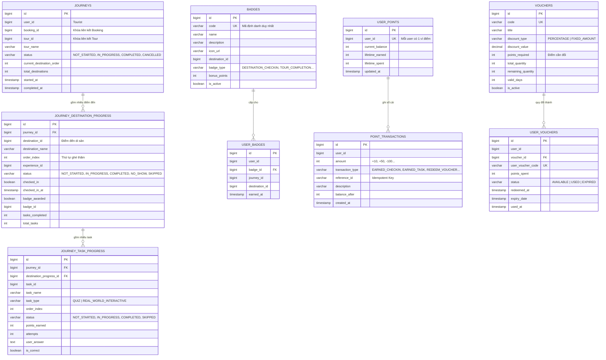

# ĐỢT 1 — TÀI LIỆU THIẾT KẾ ERD & API CONTRACT CHO BACKEND 3
*(Phân hệ: Journey & Gamification)*

---

## 1. SƠ ĐỒ THỰC THỂ LIÊN KẾT (ERD)

---

## 2. QUY TẮC RÀNG BUỘC TOÀN VẸN & CHỐNG TRÙNG THƯỞNG (IDEMPOTENCY)

1. **Chống nhận Badge trùng**:
   - Bảng `user_badges` có Unique Constraint `uk_user_badge(user_id, badge_id)`.
   - Một du khách dù quét check-in bao nhiêu lần tại 1 điểm thì cũng chỉ nhận huy hiệu của điểm đó một lần duy nhất.
2. **Chống cộng điểm trùng**:
   - Mỗi giao dịch trong `point_transactions` lưu `reference_id` (ví dụ: `TASK_{id}_J_{journeyId}`).
   - Khi cộng điểm, service kiểm tra `existsByUserIdAndReferenceId` trong cùng transaction để đảm bảo an toàn tuyệt đối.
3. **Lưu tiến độ từng bước**:
   - `journey_destination_progress` có Unique Constraint `uk_journey_destination(journey_id, destination_id)`.
   - `journey_task_progress` có Unique Constraint `uk_journey_destination_task(destination_progress_id, task_id)`.
   - Đảm bảo khi du khách làm xong bất kỳ task nào, trạng thái được persist ngay vào DB.

---

## 3. CHI TIẾT API CONTRACT CHO BACKEND 3

### 3.1. Phân hệ Journey (Hành trình)

| Method | Endpoint | Mô tả | Request Body | Response Data |
| :--- | :--- | :--- | :--- | :--- |
| `POST` | `/api/v1/journeys` | Bắt đầu hành trình mới từ Booking đã thanh toán | `StartJourneyRequest` | `JourneyResponse` |
| `GET` | `/api/v1/journeys/my` | Lấy danh sách các chuyến đi của du khách hiện tại | Không | `List<JourneyResponse>` |
| `GET` | `/api/v1/journeys/{id}` | Lấy chi tiết tiến độ hành trình (kèm danh sách điểm và task) | Không | `JourneyResponse` |
| `POST` | `/api/v1/journeys/{id}/destinations/{destinationId}/check-in` | Check-in GPS tại điểm đến & nhận Badge | `CheckInJourneyRequest` | `CheckInResultResponse` |
| `POST` | `/api/v1/journeys/{id}/tasks/{taskId}/submit` | Nộp bài Quiz hoặc giải đố GPS Puzzle & cộng Point | `SubmitTaskRequest` | `JourneyTaskProgressResponse` |
| `PATCH`| `/api/v1/journeys/{id}/destinations/{destinationId}/skip` | Bỏ qua điểm đến nếu bị trễ giờ (đánh dấu `SKIPPED`) | Không | `JourneyDestinationProgressResponse` |

### 3.2. Phân hệ Gamification (Huy hiệu, Điểm thưởng, Voucher)

| Method | Endpoint | Mô tả | Request Body | Response Data |
| :--- | :--- | :--- | :--- | :--- |
| `GET` | `/api/v1/gamification/badges` | Danh mục toàn bộ huy hiệu trên nền tảng | Không | `List<BadgeResponse>` |
| `GET` | `/api/v1/gamification/badges/my` | Danh sách huy hiệu du khách đã thu thập được | Không | `List<UserBadgeResponse>` |
| `GET` | `/api/v1/gamification/points/my` | Số dư điểm thưởng hiện tại của du khách | Không | `UserPointResponse` |
| `GET` | `/api/v1/gamification/points/history` | Lịch sử biến động điểm thưởng (cộng/tiêu điểm) | Không | `List<PointTransactionResponse>` |
| `GET` | `/api/v1/gamification/vouchers` | Danh sách voucher có thể dùng điểm đổi | Không | `List<VoucherResponse>` |
| `POST` | `/api/v1/gamification/vouchers/{voucherId}/redeem` | Dùng điểm đổi lấy mã Voucher giảm giá | Không (hoặc `voucherId` path) | `UserVoucherResponse` |
| `GET` | `/api/v1/gamification/vouchers/my` | Danh sách mã Voucher của tôi (đang có / đã dùng) | Không | `List<UserVoucherResponse>` |
