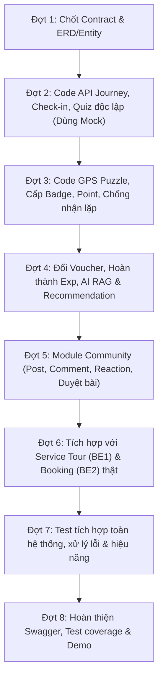

# TÀI LIỆU TỔNG HỢP NGHIỆP VỤ & KẾ HOẠCH TRIỂN KHAI CHO BACKEND 3
*(JourneyGo Platform — Phân hệ: Journey, Gamification, AI & Community)*

---

## 1. TỔNG QUAN PHÂN CHIA HỆ THỐNG (3 BACKEND)

Hệ thống JourneyGo được phân chia thành 3 mảng nghiệp vụ độc lập để các thành viên có thể song song phát triển mà không bị phụ thuộc chặn luồng (blocking):

| Phân hệ | Nhiệm vụ chính | Chiến lược phát triển độc lập |
| :--- | :--- | :--- |
| **Backend 1** | **Tour & Moderation**: Tour, TourDestination, Quản lý nội dung CP/CM, Duyệt và xuất bản Tour, API Tour public. | Kiểm thử bằng Destination/Experience có sẵn; không phụ thuộc Booking. |
| **Backend 2** | **Booking, Payment & Finance**: Booking, ExperienceSlot, Payment, Partner, Refund, Wallet, Settlement (đối soát 15 hàng tháng). | Dùng interface `TourProvider` giả lập (mock); không chờ Backend 1. |
| **Backend 3** | **Journey, Gamification, AI & Community**: Hành trình thực tế của Tourist, Check-in GPS, Task (Quiz & GPS Puzzle), Badge, Point, Voucher, AI RAG & Recommendation, Mạng xã hội Community. | **Dùng dữ liệu Tour/Booking giả lập (mock/stub); phát triển độc lập, không chờ Backend 1 & 2.** |

---

## 2. CẤU TRÚC PHÂN CẤP DỮ LIỆU CỐT LÕI

Để triển khai chuẩn nghiệp vụ, Backend 3 cần nắm vững cấu trúc phân cấp nội dung:

```text
Tour (Hành trình văn hóa, gồm 1 hoặc nhiều Destination theo thứ tự)
  │
  └── TourDestination (Bảng liên kết Tour - Destination, xác định thứ tự thăm quan: sortOrder)
        │
        └── Destination (Điểm đến di sản: kinh độ, vĩ độ, thông tin văn hóa)
              │
              └── Experience (MỖI Destination có ĐÚNG 1 Experience duy nhất)
                    │
                    └── Task (Nhiệm vụ trải nghiệm tại điểm đến: gồm 2 loại)
                          ├── TaskType 1: QUIZ (Trắc nghiệm 4 phương án)
                          └── TaskType 2: REAL_WORLD_INTERACTIVE / GPS Puzzle
                                (Đến đúng tọa độ GPS -> Giải mật mã hiện trường -> Nhập text)
```

---

## 3. CHI TIẾT CÁC MODULE VÀ QUY TẮC NGHIỆP VỤ CỦA BACKEND 3

### 3.1. Phân hệ Journey & Tiến độ (Journey Progress)

* **Điều kiện bắt đầu**: Du khách đã thanh toán thành công và có `Booking` ở trạng thái `CONFIRMED`.
* **Luồng trải nghiệm thực tế tại từng Destination**:
  1. **Bản đồ chỉ dẫn**: Hiển thị Map dẫn đường tới Destination tiếp theo theo thứ tự trong Tour.
  2. **Check-in GPS**:
     - Du khách đến địa điểm $\to$ bấm Check-in $\to$ Backend kiểm tra tọa độ GPS của thiết bị so với tọa độ Destination.
     - **Quy tắc GPS**: Định vị GPS luôn có sai số (vật cản, thời tiết, thiết bị). Backend phải sử dụng công thức tính khoảng cách (Haversine) với **bán kính dung sai (radius tolerance, ví dụ 30m - 50m)**. Có cơ chế quét mã **QR dự phòng** tại quầy/điểm đến nếu GPS gặp sự cố.
  3. **Cấp Badge (Huy hiệu)**: Cấp **ngay sau khi check-in thành công** để ghi nhận cột mốc đã đặt chân đến di tích.
  4. **Mở khóa nội dung văn hóa**: Mở khóa video, văn bản, ảnh, artifact.
     - *Lưu ý quan trọng*: **Không ép du khách phải xem hết 100% video hoặc đọc đủ thời gian** mới được làm Quiz. Chỉ cần hiển thị nội dung và nút "Bắt đầu làm bài". Nếu muốn theo dõi tiến độ đọc/xem thì lưu cờ riêng.
  5. **Làm Task - Quiz**: Trả lời câu hỏi trắc nghiệm 4 phương án liên quan đến nội dung vừa mở khóa.
  6. **Làm Task - GPS Puzzle (Thực tế)**: Sau khi xong Quiz $\to$ dẫn khách đến vị trí cụ thể $\to$ đọc câu đố/manh mối hiện trường $\to$ khách tự giải mật mã và nhập câu trả lời dạng chữ $\to$ đúng thì hoàn thành.
  7. **Hoàn thành Experience $\to$ Cộng Point**: Hoàn thành toàn bộ task tại Experience sẽ được tích lũy **Point**.
  8. **Tiếp tục hành trình**: Chuyển sang Destination kế tiếp. Khi hoàn tất Destination cuối cùng $\to$ Journey chuyển sang `COMPLETED`.

* **Quy tắc lưu tiến độ từng bước (Save Progress)**:
  - Trạng thái Experience trong Tour: `NOT_STARTED` $\to$ `IN_PROGRESS` $\to$ `COMPLETED`, cùng 2 trạng thái phụ `NO_SHOW` (bỏ lỡ hẹn), `SKIPPED` (được phép bỏ qua).
  - Khi du khách thoát ứng dụng hoặc sang ngày hôm sau (trong thời hạn hiệu lực của Booking), khi mở lại ứng dụng **phải khôi phục đúng bước đang làm**, không bắt làm lại các phần đã xong.
  - Một điểm bị `NO_SHOW` (ví dụ hết hạn slot của đối tác) **không làm hủy cả Tour**, khách vẫn được tiếp tục các điểm còn lại trong Tour.

---

### 3.2. Phân hệ Gamification (Badge, Point & Voucher)

* **Phân biệt rõ ràng Badge vs Point**:
  - **Badge**: Cột mốc vinh danh thành tích (nhận ngay lúc Check-in thành công tại Destination).
  - **Point**: Điểm thưởng tích lũy (nhận sau khi giải xong Quiz / GPS Puzzle hoặc hoàn thành Experience/Tour).
* **Cơ chế chống cấp thưởng trùng (Idempotency)**:
  - Cực kỳ quan trọng: Ngăn chặn race-condition khi du khách bấm nút nhiều lần hoặc gửi request liên tục.
  - Cần cơ chế khóa dữ liệu (Unique constraint hoặc check tồn tại trong `@Transactional`) đảm bảo 1 Tourist chỉ nhận thưởng đúng 1 lần cho 1 Task/Destination cụ thể trong chuyến đi.
* **Hệ thống Voucher**:
  - Quản lý danh mục Voucher giảm giá.
  - API cho phép du khách tiêu điểm (Point) để quy đổi mã Voucher.

---

### 3.3. Phân hệ AI (Chatbot RAG & Recommendation)
*Tài liệu yêu cầu giới hạn phạm vi AI thật rõ ràng, không để AI tự tạo dữ liệu ngoài hệ thống:*
* **Tourist Chatbot (RAG)**:
  - Truy xuất nội dung văn hóa, thông tin Tour/Destination thật trong cơ sở dữ liệu nội bộ trước khi trả lời.
  - Phải có trích dẫn nguồn nội dung.
  - **Cấm LLM tự bịa Tour, tự bịa giá vé hoặc đề xuất điểm đến không có trong hệ thống.**
* **Recommendation (Gợi ý hành trình)**:
  - Đầu vào từ Tourist: Vị trí, thời gian rảnh (ví dụ: 4 tiếng ở Huế), sở thích (lịch sử triều Nguyễn), ngân sách (500.000đ).
  - Backend lọc dữ liệu Tour/Destination thật đáp ứng đủ các tiêu chí thực tế trước.
  - LLM chỉ đóng vai trò **diễn giải / thuyết minh lý do** vì sao Tour đó phù hợp với du khách.

---

### 3.4. Phân hệ Community (Cộng đồng du lịch)

* **Vòng đời bài viết**: `DRAFT` $\to$ `PENDING_REVIEW` $\to$ `PUBLISHED` / `REJECTED` (có thể có `NEEDS_REVISION`).
* **Liên kết dữ liệu**: Bài viết có thể gắn kèm Tour, Destination, Journey Log hoặc ảnh chụp hành trình.
* **Quy tắc kiểm duyệt & bảo mật**:
  - Bình luận (Comment) và Thả tim (Reaction) chỉ được thao tác với bài viết đã `PUBLISHED`.
  - **Nếu bài viết đã duyệt mà người dùng sửa nội dung $\to$ bắt buộc quay trở lại hàng đợi duyệt (`PENDING_REVIEW`)** để chống việc sửa thành nội dung vi phạm sau khi duyệt.
  - Hỗ trợ tính năng báo cáo bài viết vi phạm (Report violation) và ẩn bài viết khi cần.

---

## 4. LỘ TRÌNH 8 ĐỢT TRIỂN KHAI CHO BACKEND 3



* **Đợt 1 — Chốt Contract & Tạo khung Entity/DB**:
  - Thiết kế ERD, Entity: `Journey`, `JourneyProgress`, `CheckInRecord`, `TaskProgress`, `Badge`, `Point`.
* **Đợt 2 — Code nghiệp vụ độc lập**:
  - API tiến độ Journey, Check-in, Task Progress, nộp Quiz và lưu kết quả (dùng mock Tour/Booking).
* **Đợt 3 — Mở rộng tương tác thực tế & Gamification**:
  - GPS Puzzle (kiểm tra bán kính vị trí + đối chiếu câu trả lời text).
  - Cấp Badge, cấp Point, cơ chế chống nhận thưởng trùng.
* **Đợt 4 — Hoàn thiện Gamification & AI bản đầu**:
  - Quản lý và quy đổi Voucher từ Point.
  - API xác nhận hoàn thành Experience.
  - Xây dựng Chatbot RAG và Recommendation trên dữ liệu mẫu.
* **Đợt 5 — Nghiệp vụ mở rộng (Community)**:
  - CRUD bài viết cộng đồng, bình luận, thả tim, báo cáo vi phạm, quy tắc kiểm duyệt bài viết.
* **Đợt 6 — Tích hợp theo Contract**:
  - Thay mock bằng Service Tour (BE 1) và Service Booking (BE 2) thật.
  - Kiểm tra quyền thực hiện Journey dựa trên trạng thái Booking thực tế.
* **Đợt 7 — Kiểm thử tích hợp**:
  - Test E2E toàn luồng: Mua Tour $\to$ Check-in GPS $\to$ Quiz/GPS Puzzle $\to$ Nhận Badge/Point $\to$ Đổi Voucher $\to$ Đăng bài Community.
* **Đợt 8 — Hoàn thiện Backend**:
  - Hoàn thiện Unit Test & Integration Test.
  - Chuẩn hóa Swagger / OpenAPI Documentation.

---

## 5. DANH SÁCH BẢNG / ENTITY DỰ KIẾN CẦN THIẾT KẾ CHO BACKEND 3

1. **Nhóm Journey & Check-in**:
   - `journeys`: Quản lý 1 chuyến đi của du khách (gắn với `bookingId`, `tourId`, `userId`, `status`).
   - `journey_destinations` / `experience_progress`: Trạng thái từng điểm đến (`NOT_STARTED`, `IN_PROGRESS`, `COMPLETED`, `NO_SHOW`, `SKIPPED`).
   - `check_in_records`: Lịch sử check-in GPS tại địa điểm (kinh độ, vĩ độ, thời gian, phương thức: GPS hoặc QR).
2. **Nhóm Task Progress & Kết quả**:
   - `task_progress`: Lưu tiến độ làm task của user (`COMPLETED`, điểm số, số lần thử).
   - `user_task_answers`: Câu trả lời quiz hoặc câu trả lời chữ của GPS Puzzle.
3. **Nhóm Gamification**:
   - `badges`: Danh mục huy hiệu (tên, icon, điều kiện).
   - `user_badges`: Huy hiệu du khách đã nhận (kèm thời gian cấp, `checkInId`).
   - `user_points`: Số dư điểm hiện tại của user.
   - `point_transactions`: Lịch sử cộng/trừ điểm (giao dịch điểm, lý do).
   - `vouchers`: Danh mục voucher giảm giá (mã, mức giảm, điểm cần đổi, hạn dùng).
   - `user_vouchers`: Voucher mà user đã dùng điểm quy đổi.
4. **Nhóm Community**:
   - `community_posts`: Bài viết (tiêu đề, nội dung, status: `DRAFT`, `PENDING_REVIEW`, `PUBLISHED`, `REJECTED`, tags tour/destination).
   - `post_media`: Danh sách ảnh/video đính kèm bài viết.
   - `post_comments`: Bình luận trên bài viết.
   - `post_reactions`: Thả tim / like bài viết.
   - `post_reports`: Báo cáo vi phạm bài viết.
