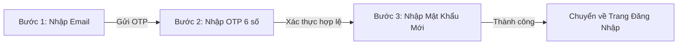

# Hướng Dẫn Tích Hợp Quên Mật Khẩu & Đổi Mật Khẩu Cho Frontend

Tài liệu này hướng dẫn các bước thiết lập môi trường và tích hợp các API mới (**Forgot Password**, **Verify OTP**, **Reset Password**, **Change Password**) sau bản cập nhật tính năng.

---

## 1. Lưu Ý Thiết Lập Môi Trường (Cho Toàn Bộ Dev / Frontend Dev)

Do file `.env` chứa thông tin nhạy cảm (mật khẩu database, app password của mail) nên đã được đưa vào `.gitignore`.

👉 **Khi pull code mới về, mỗi lập trình viên cần làm như sau:**
1. Di chuyển vào thư mục `backend/`.
2. Tạo file `.env` bằng cách sao chép từ file mẫu:
   ```bash
   cp .env.example .env
   # Hoặc trên Windows PowerShell:
   Copy-Item .env.example .env
   ```
3. Mở file `.env` và kiểm tra cấu hình:
   - Nếu bạn muốn gửi mail OTP thật về hộp thư cá nhân: Điền `SPRING_MAIL_USERNAME` và `SPRING_MAIL_PASSWORD` (App Password của Google).
   - Nếu chưa có App Password Gmail: Bạn vẫn có thể test bình thường vì Backend **luôn in mã OTP ra Terminal log**:
     ```text
     ===> [OTP RESET PASSWORD] Đang gửi mã OTP đến email: user@gmail.com | OTP: 123456
     ```

---

## 2. Danh Sách API Mới

Base URL: `http://localhost:8088/api/v1/auth`

| STT | Endpoint | Method | Quyền truy cập | Mô tả |
| :--- | :--- | :---: | :---: | :--- |
| 1 | `/forgot-password` | `POST` | Public | Gửi mã OTP 6 số đến email của người dùng |
| 2 | `/verify-otp` | `POST` | Public | Kiểm tra mã OTP còn hiệu lực không trước khi cho nhập mật khẩu mới |
| 3 | `/reset-password` | `POST` | Public | Đặt lại mật khẩu mới bằng OTP (khi chưa đăng nhập) |
| 4 | `/change-password` | `POST` | **Bearer Auth** | Đổi mật khẩu dành cho người dùng đã đăng nhập |

---

## 3. Chi Tiết Request & Response Từng API

### 3.1. Quên mật khẩu - Gửi mã OTP (`POST /api/v1/auth/forgot-password`)
- **Request Body:**
  ```json
  {
    "email": "user@gmail.com"
  }
  ```
- **Response thành công (HTTP 200):**
  ```json
  {
    "code": 200,
    "message": "Mã OTP khôi phục mật khẩu đã được gửi đến email của bạn",
    "data": null
  }
  ```
- **Lưu ý:** Mã OTP có thời hạn **10 phút**. Nếu email không tồn tại trong hệ thống sẽ trả về lỗi `404 - USER_NOT_EXISTED`.

---

### 3.2. Kiểm tra mã OTP (`POST /api/v1/auth/verify-otp`)
API này dùng để kiểm tra nhanh xem OTP có đúng và còn hạn không, giúp chuyển sang bước nhập mật khẩu mới mượt mà:
- **Request Body:**
  ```json
  {
    "email": "user@gmail.com",
    "otp": "123456"
  }
  ```
- **Response thành công (HTTP 200):**
  ```json
  {
    "code": 200,
    "message": "Mã OTP hợp lệ",
    "data": true
  }
  ```

---

### 3.3. Đặt lại mật khẩu mới (`POST /api/v1/auth/reset-password`)
- **Request Body:**
  ```json
  {
    "email": "user@gmail.com",
    "otp": "123456",
    "newPassword": "NewPassword123@",
    "confirmPassword": "NewPassword123@"
  }
  ```
- **Response thành công (HTTP 200):**
  ```json
  {
    "code": 200,
    "message": "Đặt lại mật khẩu thành công, vui lòng đăng nhập bằng mật khẩu mới",
    "data": null
  }
  ```
- **Hành vi hệ thống:** Đổi mật khẩu thành công sẽ tự động **hủy toàn bộ phiên đăng nhập cũ (Refresh Tokens)** của tài khoản này để đảm bảo an toàn.

---

### 3.4. Đổi mật khẩu khi đang đăng nhập (`POST /api/v1/auth/change-password`)
- **Headers:** `Authorization: Bearer <access_token>`
- **Request Body:**
  ```json
  {
    "currentPassword": "OldPassword123@",
    "newPassword": "NewPassword123@",
    "confirmPassword": "NewPassword123@"
  }
  ```
- **Response thành công (HTTP 200):**
  ```json
  {
    "code": 200,
    "message": "Đổi mật khẩu thành công",
    "data": null
  }
  ```
- **Lưu ý:**
  - `newPassword` phải từ 6 ký tự trở lên và khác với mật khẩu cũ.
  - Đối với tài khoản đăng ký bằng Google chưa từng đặt mật khẩu, trường `currentPassword` có thể để trống.

---

## 4. Code Mẫu Tích Hợp Frontend

### 4.1. Thêm vào `frontend/src/features/auth/services/authService.js`

```javascript
// frontend/src/features/auth/services/authService.js
import { apiClient } from "@/services/apiClient";

export const authService = {
  // ... các hàm cũ giữ nguyên

  // Gửi OTP quên mật khẩu
  forgotPassword: async (email) => {
    return apiClient.post("/auth/forgot-password", { email });
  },

  // Xác thực OTP
  verifyOtp: async (email, otp) => {
    return apiClient.post("/auth/verify-otp", { email, otp });
  },

  // Đặt lại mật khẩu với OTP
  resetPassword: async ({ email, otp, newPassword, confirmPassword }) => {
    return apiClient.post("/auth/reset-password", {
      email,
      otp,
      newPassword,
      confirmPassword,
    });
  },

  // Đổi mật khẩu (Cần đăng nhập)
  changePassword: async ({ currentPassword, newPassword, confirmPassword }) => {
    return apiClient.post("/auth/change-password", {
      currentPassword,
      newPassword,
      confirmPassword,
    });
  },
};
```

---

### 4.2. Gợi Ý Luồng Giao Diện Quên Mật Khẩu (3 Bước)



- **Bước 1:** Người dùng bấm "Quên mật khẩu?" $\rightarrow$ Nhập `email` $\rightarrow$ gọi `authService.forgotPassword(email)`.
- **Bước 2:** Hiện màn hình nhập 6 ô số OTP (hoặc 1 input text 6 ký tự) $\rightarrow$ gọi `authService.verifyOtp(email, otp)`.
- **Bước 3:** Cho phép người dùng nhập `newPassword` & `confirmPassword` $\rightarrow$ gọi `authService.resetPassword(...)` $\rightarrow$ Hiển thị thông báo thành công và chuyển hướng về trang Login.
