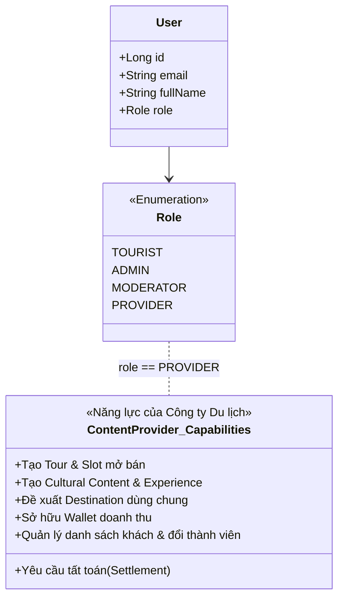
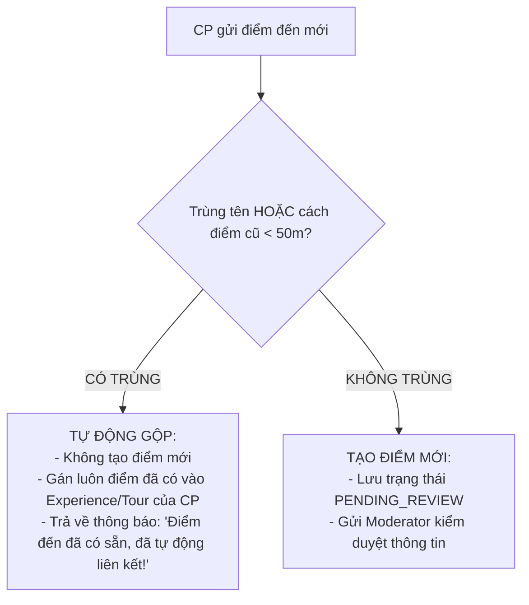
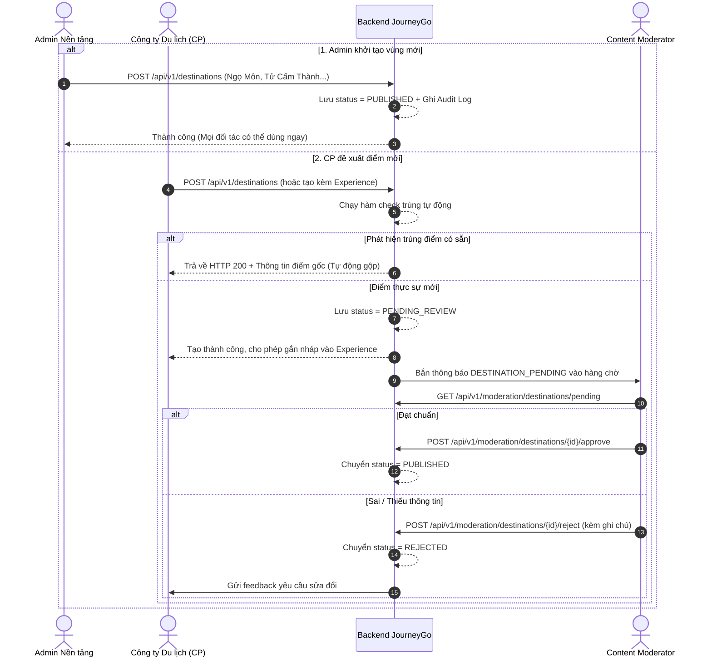
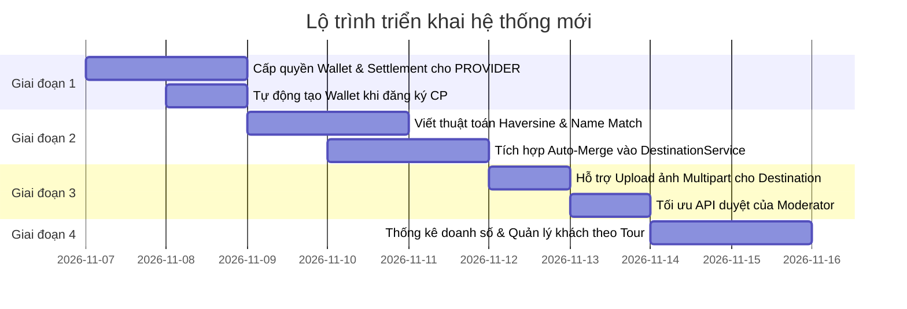

# TÀI LIỆU KIẾN TRÚC & KẾ HOẠCH TRIỂN KHAI: GỘP PARTNER VÀO CONTENT PROVIDER & TỰ ĐỘNG HÓA QUẢN LÝ ĐIỂM ĐẾN
> **Dự án**: JourneyGo Monolith Backend  
> **Phiên bản tài liệu**: 2.0 (Bám sát đặc tả `Flow.txt`)  
> **Trạng thái**: Kế hoạch chính thức (Approved Plan)

---

## 1. TỔNG QUAN VÀ MỤC TIÊU

### 1.1. Hiện trạng trước đây
* Hệ thống phân tách thành hai đối tượng độc lập:
  * **Content Provider (`ROLE_PROVIDER`)**: Người làm nội dung (tạo Tour, Destination, Experience, Cultural Content).
  * **Partner (`ROLE_PARTNER`)**: Đối tác kinh doanh/tài chính sở hữu Ví tiền (`Wallet`), nhận doanh thu bán vé và yêu cầu tất toán (`Settlement`).
* **Hạn chế**: Quy trình kiểm duyệt và phân công cồng kềnh (Partner đề xuất điểm thô $\rightarrow$ Admin phân công $\rightarrow$ CP tạo điểm $\rightarrow$ Moderator duyệt 2 vòng). Dễ gây trùng lặp điểm đến nếu nhiều bên cùng gửi.

### 1.2. Mục tiêu tái cấu trúc
1. **Gộp Partner vào Content Provider**:
   * Định danh duy nhất: **Content Provider chính là Công ty du lịch / Đối tác dịch vụ**.
   * Một tài khoản `PROVIDER` vừa có quyền tạo và quản lý nội dung tour/điểm đến, vừa sở hữu Ví doanh thu (`Wallet`), theo dõi tiền bán vé và yêu cầu rút tiền/tất toán.
2. **Quy tắc sở hữu Điểm đến (Destination)**:
   * Điểm đến là tài nguyên thực tế **dùng chung cho toàn nền tảng**, không một đối tác nào sở hữu riêng.
   * **Admin tạo**: Xuất bản ngay (`PUBLISHED`) phục vụ mở vùng mới.
   * **CP đề xuất**: Tạo điểm mới khi dựng Tour/Experience.
3. **Tự động hóa Check trùng và Gộp điểm (Auto-Merge) 100% tại Backend**:
   * Backend tự động phân tích tọa độ GPS và tên địa điểm.
   * Nếu trùng điểm đã có $\rightarrow$ Backend **tự động gộp**, liên kết Experience vào điểm gốc ngay lập tức, không để bản ghi rác và không cần Moderator can thiệp.
   * Nếu thực sự mới $\rightarrow$ Chuyển `PENDING_REVIEW` để Moderator thẩm định chất lượng.

---

## 2. KIẾN TRÚC VAI TRÒ (ROLE ARCHITECTURE)

| Vai trò (Role) | Đối tượng thực tế | Trách nhiệm chính trong hệ thống |
| :--- | :--- | :--- |
| **`TOURIST`** | Du khách | Xem tour, đặt chỗ, thanh toán (cá nhân/nhóm), tham gia trải nghiệm, quét QR check-in, trả lời quiz nhận điểm/huy hiệu. |
| **`PROVIDER`** | **Công ty du lịch / Đối tác** | **(Đã gộp Partner)**: Tạo Tour, Content, Experience; đề xuất Destination; quản lý ví doanh thu, yêu cầu tất toán; vận hành tour. |
| **`MODERATOR`** | Ban kiểm duyệt | Duyệt các Destination thực sự mới, duyệt Tour, duyệt bài viết văn hóa, duyệt trải nghiệm và xử lý báo cáo vi phạm. |
| **`ADMIN`** | Quản trị nền tảng | Tạo các Destination lớn ban đầu (`PUBLISHED`), quản lý người dùng, cấu hình tỷ lệ hoa hồng, duyệt các đợt tất toán tiền. |

---

## 3. CƠ CHẾ TỰ ĐỘNG CHECK TRÙNG & GỘP ĐIỂM ĐẾN (ĐƠN GIẢN)

Khi Content Provider (CP) bấm tạo điểm đến, Backend chỉ thực hiện **2 bước kiểm tra nhanh**:

### 3.1. Hai quy tắc kiểm tra trùng
1. **Kiểm tra Tên & Khu vực**: Tên điểm đến đã tồn tại trong cùng Tỉnh/Thành phố (không phân biệt hoa/thường, dấu cách).
2. **Kiểm tra Tọa độ GPS**: Điểm mới có tọa độ cách điểm cũ dưới **50 mét**.

---

### 3.2. Cách Backend xử lý tự động

> **Lợi ích:**
> * **CP**: Không bị lỗi tạo trùng, không phải đợi duyệt nếu điểm đó đã có trên hệ thống $\rightarrow$ làm Tour tiếp được ngay.
> * **Moderator**: Không cần phải soi xem điểm có bị trùng hay không, chỉ tập trung duyệt các điểm thực sự mới.

---

## 4. QUY TRÌNH NGHIỆP VỤ DESTINATION TOÀN DIỆN

### 4.1. Phân loại luồng tạo Destination

---

## 5. BẢNG THIẾT KẾ ENDPOINT API CHI TIẾT

### 5.1. Quản lý Điểm đến (Destination Module)
| Phương thức | Endpoint | Phân quyền | Mô tả chức năng |
| :--- | :--- | :--- | :--- |
| `POST` | `/api/v1/destinations` | `ADMIN`, `PROVIDER` | **Admin**: Tạo điểm `PUBLISHED` ngay. **CP**: Đề xuất điểm mới. Tự động kiểm tra trùng: nếu trùng trả về điểm cũ; nếu mới tạo `PENDING_REVIEW`. Hỗ trợ upload ảnh Multipart/Cloudinary. |
| `GET` | `/api/v1/destinations` | Public | Lấy danh sách điểm đến đã xuất bản (`PUBLISHED`). |
| `GET` | `/api/v1/destinations/my` | `PROVIDER`, `ADMIN` | CP xem danh sách các điểm do mình đề xuất (bao gồm cả `PENDING_REVIEW`, `REJECTED`). |
| `PUT` | `/api/v1/destinations/{id}` | `ADMIN`, `PROVIDER` | Chỉnh sửa thông tin điểm đến (khi bị reject hoặc sửa bản nháp). |

### 5.2. Kiểm duyệt Điểm đến (Moderator Module)
| Phương thức | Endpoint | Phân quyền | Mô tả chức năng |
| :--- | :--- | :--- | :--- |
| `GET` | `/api/v1/moderation/destinations/pending` | `MODERATOR`, `ADMIN` | Xem danh sách các điểm thực sự mới cần duyệt. |
| `POST` | `/api/v1/moderation/destinations/{id}/approve` | `MODERATOR`, `ADMIN` | Phê duyệt điểm đến $\rightarrow$ Chuyển thành `PUBLISHED`. |
| `POST` | `/api/v1/moderation/destinations/{id}/reject` | `MODERATOR`, `ADMIN` | Từ chối điểm đến kèm lý do chi tiết $\rightarrow$ Chuyển thành `REJECTED`. |

### 5.3. Tài chính & Tất toán cho Content Provider (Gộp từ Partner sang)
| Phương thức | Endpoint | Phân quyền | Mô tả chức năng |
| :--- | :--- | :--- | :--- |
| `GET` | `/api/v1/wallet/my` | `PROVIDER`, `ADMIN` | CP xem số dư ví, tiền chờ về từ các tour đang chạy. |
| `GET` | `/api/v1/wallet/transactions` | `PROVIDER`, `ADMIN` | Xem lịch sử cộng/trừ tiền chi tiết theo từng đơn booking tour. |
| `POST` | `/api/v1/settlements` | `PROVIDER`, `ADMIN` | CP tạo yêu cầu tất toán rút doanh thu về tài khoản ngân hàng. |
| `GET` | `/api/v1/settlements/my` | `PROVIDER`, `ADMIN` | CP theo dõi trạng thái các đợt rút tiền (`PENDING`, `APPROVED`, `PAID`). |
| `POST` | `/api/v1/settlements/{id}/approve` | `ADMIN` | Admin phê duyệt giải ngân lệnh tất toán của CP. |

---

## 6. LỘ TRÌNH TRIỂN KHAI THEO GIAI ĐOẠN

### Chi tiết các giai đoạn:
* **Giai đoạn 1: Mở rộng Tài chính cho CP**:
  * Đảm bảo mọi tài khoản `ROLE_PROVIDER` có liên kết với `Wallet`.
  * Cập nhật các Controller tài chính cho phép `PROVIDER` truy cập dữ liệu của chính mình.
* **Giai đoạn 2: Backend Auto-Deduplication & Merge**:
  * Triển khai hàm tính khoảng cách GPS chính xác.
  * Trong `DestinationService.createDestination()`: nếu trùng $\rightarrow$ return điểm cũ; nếu không $\rightarrow$ tạo mới `PENDING_REVIEW`.
* **Giai đoạn 3: Nâng cấp trải nghiệm tạo & duyệt**:
  * Cho phép CP upload nhiều ảnh trực tiếp qua Cloudinary.
  * Tinh chỉnh Swagger UI rõ ràng.
* **Giai đoạn 4: Quản lý Tour & Vận hành**:
  * Cung cấp API báo cáo số lượng vé bán ra theo Tour và Slot cho CP.
