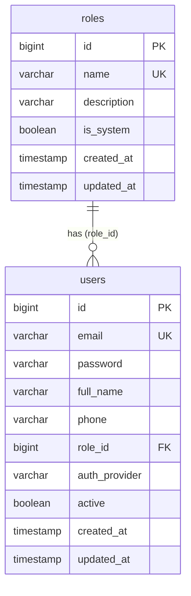

# HƯỚNG DẪN & TÀI LIỆU REFACTOR ROLE THÀNH BẢNG RIÊNG (ROLE ENTITY - OPTION 1)

> **Tài liệu tham khảo kỹ thuật**: Ghi chép chi tiết toàn bộ kiến trúc, các thay đổi code, lược đồ database và hướng dẫn mở rộng sau khi refactor `Role` từ Enum sang JPA Entity (Bảng `roles`) trong Backend JourneyGo.

---

## 1. Bối cảnh & Mục đích

### 1.1. Thực trạng trước khi refactor
- Trước đây, `Role` chỉ là một **Java Enum** (`Role { TOURIST, ADMIN, CONTENT_MODERATOR, CONTENT_PROVIDER }`).
- Trong database, bảng `users` lưu giá trị role dưới dạng một chuỗi VARCHAR thông qua `RoleConverter` (`@Convert(converter = RoleConverter.class)`).
- **Hạn chế**:
  - Không thể thêm vai trò mới một cách linh hoạt (dynamic roles) trong quá trình ứng dụng chạy mà không cần sửa code và build lại backend.
  - Không có trường mô tả, trạng thái role hệ thống hay metadata quản lý quyền hạn đi kèm.

### 1.2. Mục tiêu đạt được
- Tách `Role` thành một **bảng riêng (`roles`)** trong cơ sở dữ liệu.
- Áp dụng **Hướng 1 (Quan hệ 1 - N)**: Mỗi người dùng có đúng **1 vai trò** tại một thời điểm thông qua khóa ngoại `role_id` trong bảng `users`.
- **Tương thích ngược 100%**:
  - Frontend và Mobile App không cần sửa đổi bất kỳ code nào: request/response JSON vẫn nhận và trả về chuỗi role (ví dụ: `"TOURIST"`, `"ADMIN"`) như trước.
  - Các Service hiện tại kiểm tra quyền (như `DestinationService`, `TourService`, `CulturalContentService`) vẫn tiếp tục hoạt động ổn định.
- **Tự động khởi tạo dữ liệu (Auto Seeding)**: Tự tạo sẵn các vai trò chuẩn hệ thống khi backend khởi động lần đầu.

---

## 2. Lược đồ Cơ sở dữ liệu (Database Schema)

### 2.1. Bảng `roles` (Mới)
```sql
CREATE TABLE roles (
    id BIGINT AUTO_INCREMENT PRIMARY KEY,
    name VARCHAR(50) NOT NULL UNIQUE,
    description VARCHAR(255),
    is_system BOOLEAN NOT NULL DEFAULT TRUE,
    created_at TIMESTAMP NOT NULL,
    updated_at TIMESTAMP
);

CREATE UNIQUE INDEX idx_roles_name ON roles(name);
```

### 2.2. Bảng `users` (Cập nhật)
- Thêm cột khóa ngoại: `role_id BIGINT REFERENCES roles(id)`.
- Xóa bỏ phụ thuộc vào cột enum chuỗi cũ.



---

## 3. Chi tiết các file thay đổi & Thêm mới

### 3.1. Entity & Repository
- **[`Role.java`](file:///d:/S9/journey-go/backend/src/main/java/com/journeygo/modules/user/entity/Role.java)**:
  - Khai báo `@Entity @Table(name = "roles")`.
  - Giữ lại các hằng số tên vai trò tĩnh để tiện sử dụng:
    ```java
    public static final String TOURIST = "TOURIST";
    public static final String ADMIN = "ADMIN";
    public static final String CONTENT_MODERATOR = "CONTENT_MODERATOR";
    public static final String CONTENT_PROVIDER = "CONTENT_PROVIDER";
    ```
  - Hỗ trợ JSON Serialization/Deserialization tương thích ngược:
    - `@JsonValue public String getName()`: Jackson tự động serialize entity `Role` thành chuỗi `"TOURIST"`, `"ADMIN"`...
    - `@JsonCreator public static Role fromString(String value)`: Cho phép client gửi JSON dạng `"TOURIST"` hoặc `"ADMIN"` và Jackson tự động map thành đối tượng `Role`. Hỗ trợ chuyển đổi từ alias `"USER"` cũ sang `"TOURIST"`.
  - Cung cấp các phương thức tiện ích: `isContentProvider()`, `isAdmin()`, `isContentModerator()`, `isTourist()`, `valueOf(String)`, `of(String)`.
- **[`RoleRepository.java`](file:///d:/S9/journey-go/backend/src/main/java/com/journeygo/modules/user/repository/RoleRepository.java)** (File mới):
  - Kế thừa `JpaRepository<Role, Long>`.
  - Bổ sung `Optional<Role> findByName(String name)` và `boolean existsByName(String name)`.
- **`RoleConverter.java`**:
  - Đã xóa bỏ (`git rm`) vì không còn cần thiết.

### 3.2. Cập nhật Model & Specification
- **[`User.java`](file:///d:/S9/journey-go/backend/src/main/java/com/journeygo/modules/user/entity/User.java)**:
  ```java
  @ManyToOne(fetch = FetchType.EAGER)
  @JoinColumn(name = "role_id")
  private Role role;
  ```
- **[`UserSpecifications.java`](file:///d:/S9/journey-go/backend/src/main/java/com/journeygo/modules/user/repository/UserSpecifications.java)**:
  - Cập nhật logic lọc người dùng:
    ```java
    cb.equal(root.get("role").get("name"), role.getName())
    ```

### 3.3. Dữ liệu khởi tạo (Data Initializer)
- **[`DataInitializer.java`](file:///d:/S9/journey-go/backend/src/main/java/com/journeygo/config/DataInitializer.java)**:
  - Hàm `seedRoles()`: Khởi tạo 4 vai trò mặc định nếu bảng `roles` chưa có:
    - `ADMIN` ("Quản trị viên hệ thống")
    - `CONTENT_MODERATOR` ("Kiểm duyệt viên nội dung")
    - `CONTENT_PROVIDER` ("Đối tác cung cấp nội dung và trải nghiệm")
    - `TOURIST` ("Khách du lịch")
  - Khi seed các tài khoản admin/moderator/provider/tourist mẫu: Lookup vai trò tương ứng từ `roleRepository`.
  - Migrate an toàn: Nếu trong database có user nào có `role == null`, tự động gán role mặc định là `TOURIST`.

### 3.4. Cập nhật Service & Security
- **[`AuthService.java`](file:///d:/S9/journey-go/backend/src/main/java/com/journeygo/modules/auth/service/AuthService.java)**:
  - Inject `RoleRepository`.
  - Phương thức `register(...)`: Tìm kiếm role `TOURIST` từ database và gán cho tài khoản mới.
  - Phương thức `processGoogleAuth(...)`: Tìm kiếm role được yêu cầu hoặc fallback về `TOURIST` từ database khi tạo tài khoản Google mới.
- **[`OAuth2AuthenticationSuccessHandler.java`](file:///d:/S9/journey-go/backend/src/main/java/com/journeygo/security/oauth2/OAuth2AuthenticationSuccessHandler.java)**:
  - Inject `RoleRepository`, gán role `TOURIST` entity khi tạo tài khoản OAuth2 mới.
- **[`UserService.java`](file:///d:/S9/journey-go/backend/src/main/java/com/journeygo/modules/user/service/UserService.java)**:
  - Inject `RoleRepository`.
  - `createUser`: Tìm role theo tên truyền vào trong `AdminCreateUserRequest`. Nếu không tìm thấy, ném ngoại lệ `ROLE_NOT_FOUND`.
  - `updateUserRole`: Tìm role mới theo tên từ `UpdateRoleRequest` và gán cho user.
  - `updateUser`: Cập nhật role nếu trường `role` trong `AdminUpdateUserRequest` được cung cấp.
- **[`UserPrincipal.java`](file:///d:/S9/journey-go/backend/src/main/java/com/journeygo/security/UserPrincipal.java)**:
  - Lấy tên vai trò cho Spring Security qua `user.getRole() != null ? user.getRole().getName() : Role.TOURIST`.
- **[`ErrorCode.java`](file:///d:/S9/journey-go/backend/src/main/java/com/journeygo/common/exception/ErrorCode.java)**:
  - Thêm mã lỗi:
    ```java
    ROLE_NOT_FOUND(1038, "Vai trò người dùng không tồn tại", HttpStatus.NOT_FOUND),
    ```

---

### 3.5. API Quản lý Vai trò (Role Management APIs)
- **[`RoleController.java`](file:///d:/S9/journey-go/backend/src/main/java/com/journeygo/modules/user/controller/RoleController.java)** & **[`RoleService.java`](file:///d:/S9/journey-go/backend/src/main/java/com/journeygo/modules/user/service/RoleService.java)**:
  - `@PreAuthorize("hasRole('ADMIN')")`: Dành riêng cho quản trị viên.
  - `GET /api/v1/roles`: Lấy toàn bộ danh sách vai trò hiện có trong hệ thống (sắp xếp theo ID tăng dần).
  - `POST /api/v1/roles`: Tạo mới một vai trò tùy chỉnh (`is_system = false`). Tên vai trò tự động được chuẩn hóa chữ hoa (`toUpperCase()`). Kiểm tra không được trùng lặp tên (`ROLE_EXISTED`).
  - DTOs: [`CreateRoleRequest.java`](file:///d:/S9/journey-go/backend/src/main/java/com/journeygo/modules/user/dto/CreateRoleRequest.java), [`RoleResponse.java`](file:///d:/S9/journey-go/backend/src/main/java/com/journeygo/modules/user/dto/RoleResponse.java).

### 3.6. Ràng buộc bảo vệ tài khoản Quản trị viên (Admin Protection Rules)
- Trong [`UserService.java`](file:///d:/S9/journey-go/backend/src/main/java/com/journeygo/modules/user/service/UserService.java):
  - **Admin không thể tự khóa tài khoản của mình**: Ném lỗi `CANNOT_DEACTIVATE_SELF`.
  - **Admin không thể khóa tài khoản của một Admin khác**: Khi thao tác vô hiệu hóa (qua `setUserActiveStatus` hoặc `updateUser` với `active: false`), nếu đối tượng mục tiêu có vai trò là `ADMIN`, hệ thống lập tức từ chối và ném lỗi `CANNOT_DEACTIVATE_ADMIN` (HTTP 403 Forbidden).

---

## 4. Kiểm thử & Đảm bảo chất lượng (Verification)

Tất cả unit tests đã được cập nhật tương thích với `Role` entity, `RoleRepository` mock và các ràng buộc bảo vệ Admin:
- **`RoleServiceTest.java`**: 3/3 tests passed (Lấy danh sách, tạo thành công, chặn trùng tên).
- **`UserServiceTest.java`**: 14/14 tests passed (Thêm test case chặn khóa self-admin và other-admin).
- **`AuthServiceGoogleTest.java`**: 3/3 tests passed.
- **`AuthServicePasswordTest.java`**: 8/8 tests passed.
- **`DestinationServiceWorkflowTest.java`**: 8/8 tests passed.
- **`CulturalContentServiceTest.java`**: 6/6 tests passed.
- **Toàn bộ Test Suite Backend**: **79/79 tests passed (0 failures, 0 errors)**.

---

## 5. Hướng dẫn Mở rộng trong tương lai

Khi hệ thống phát triển đến giai đoạn cần quản lý phân quyền chuyên sâu hơn:

### 5.1. Mở rộng CRUD Vai trò động (Dynamic Role Management)
- Hệ thống đã có sẵn:
  - `GET /api/v1/roles`: Lấy danh sách tất cả các vai trò.
  - `POST /api/v1/roles`: Tạo vai trò tùy chỉnh mới (`is_system = false`).
- Các tính năng có thể mở rộng tiếp theo:
  - `PUT /api/v1/roles/{id}`: Sửa mô tả vai trò (chỉ cho phép sửa nếu `is_system == false`).
  - `DELETE /api/v1/roles/{id}`: Xóa vai trò tùy chỉnh khi không còn user nào gán vai trò này.

### 5.2. Nâng cấp lên RBAC (Role-Based Access Control) với Permissions
Nếu sau này cần phân quyền chi tiết (ví dụ: `READ_DESTINATION`, `CREATE_TOUR`, `APPROVE_REVIEW`):
1. Tạo bảng `permissions` (`id`, `name`, `code`, `description`).
2. Tạo bảng liên kết `role_permissions` (`role_id`, `permission_id`).
3. Gán danh sách `permissions` vào `Role` qua `@ManyToMany` hoặc bảng trung gian.
4. Trong `UserPrincipal.java`, nạp authorities gồm cả vai trò (`ROLE_...`) và từng permission riêng lẻ để dùng với `@PreAuthorize("hasAuthority('APPROVE_REVIEW')")`.

### 5.3. Nâng cấp từ 1 User - 1 Role sang 1 User - Nhiều Roles (N - N)
Nếu một ngày một tài khoản vừa có thể là `CONTENT_PROVIDER` vừa có thể là `CONTENT_MODERATOR`:
1. Tạo bảng liên kết `user_roles` (`user_id`, `role_id`).
2. Trong `User.java`, thay `@ManyToOne private Role role;` thành `@ManyToMany private Set<Role> roles;`.
3. Trong `UserPrincipal.java`, duyệt qua danh sách `roles` để nạp danh sách `SimpleGrantedAuthority`.
